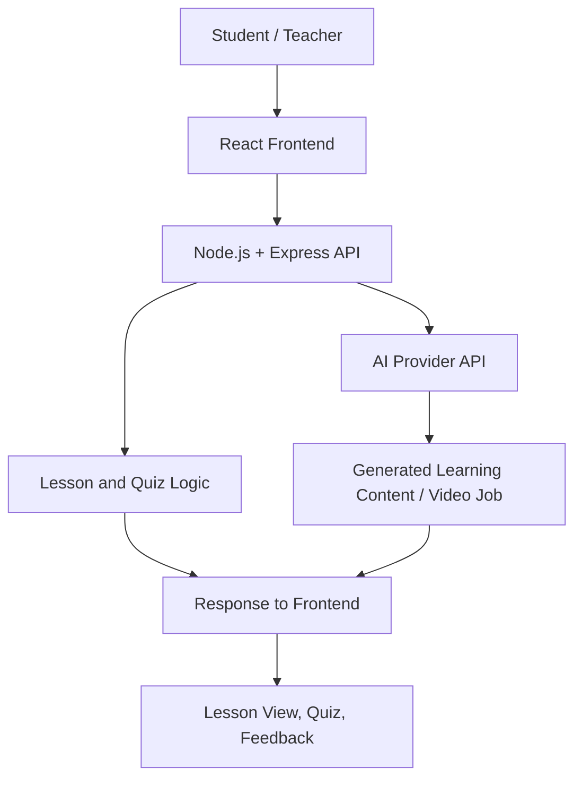

# EduArch Technical Design Document

**Status:** Draft — validate against the current implementation before treating this document as final.

## 1. Purpose

EduArch is intended to support CBSE learning with lesson content, animated educational videos, quizzes, gamified activities, and AI-assisted learning support. The platform aims to complement classroom teaching and make learning more engaging.

## 2. High-Level Architecture

This is a conceptual architecture. Modify it to reflect the services and data stores actually present in the repository.

## 3. Main Components

### Frontend — React
- Presents lesson pages, language selection, video playback, quizzes, and feedback.
- Calls backend endpoints for features that require server-side processing.
- Must not contain private AI API keys.

### Backend — Node.js and Express
- Exposes HTTP endpoints to the frontend.
- Validates request data and handles errors.
- Calls AI services from the server when configured.
- Keeps secrets in server-side environment variables.

### AI Integration
- The project may use Google Gemini / Google AI services for learning content or video generation, depending on configured APIs and access.
- The backend should report pending, successful, and failed generation states honestly.
- AI-generated content should be checked for accuracy, age suitability, and curriculum alignment.

### Learning Content and Assessment
- Lessons include a title, grade/subject metadata as appropriate, language, and content.
- Quiz items include a question, answer options, and a correct answer identifier.
- The sample JSON files are examples only; align schemas with the actual application.

## 4. Typical Request Flow

1. Student chooses a lesson and language.
2. React displays lesson content or requests it from the backend.
3. For AI-backed features, the frontend sends a request to the Express API.
4. The server validates the request and calls the configured AI provider.
5. The frontend displays the returned content or generation status.
6. Student answers a quiz and receives feedback.
7. Progress may be shown or stored if that feature is implemented.

## 5. API Notes

If the existing backend includes these routes, document them here and verify their actual request/response schemas:

| Route | Intended purpose |
|---|---|
| `POST /api/generate-video` | Start a video generation job |
| `GET /api/video-status/:jobId` | Check the status of a generation job |

These route names are based on the described project workflow. Confirm they exist and document required request fields, response fields, status codes, rate limits, and failure behavior from the current source code.

## 6. Configuration

Use `.env.example` as a non-secret template. Typical variables may include:
- `GEMINI_API_KEY` — server-side AI key, if used
- `PORT` — backend port, if configurable
- `CLIENT_ORIGIN` — allowed frontend origin, if CORS is configured

Do not assume these names are correct until compared with the code. Never commit `.env`.

## 7. Security, Privacy, and Reliability

- Validate request bodies and restrict allowed inputs.
- Keep AI credentials on the server.
- Configure CORS for known frontend origins.
- Add request timeouts, useful error messages, and appropriate rate limits.
- Avoid collecting unnecessary student information.
- Do not use real student names or records in test fixtures.
- Handle unavailable AI services without pretending a request succeeded.
- Review generated learning material before classroom use.

## 8. Known Design Questions to Resolve

- Where are lessons and quiz results stored, if at all?
- Is authentication implemented?
- Are English and Tamil content stored separately or generated on demand?
- How are video files stored and served?
- Which AI models/endpoints are actually enabled for the API key and cloud project?
- Which test framework and npm scripts are configured?
- Which features are implemented, partially implemented, or planned?

## 9. Deployment

Deployment depends on the current repository and hosting environment. Configure frontend and backend environment variables separately, use HTTPS in production, restrict secrets to server-side configuration, and verify the build and API health before release.
